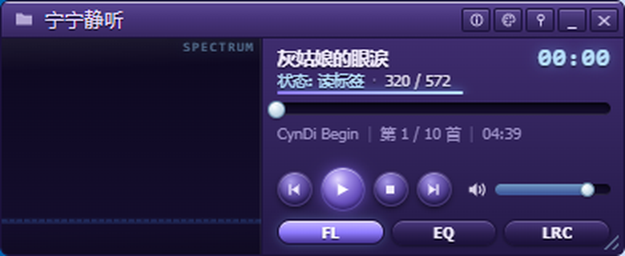
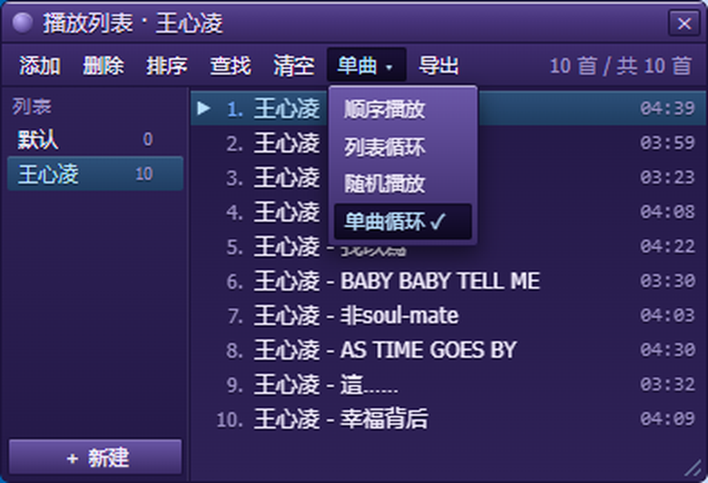
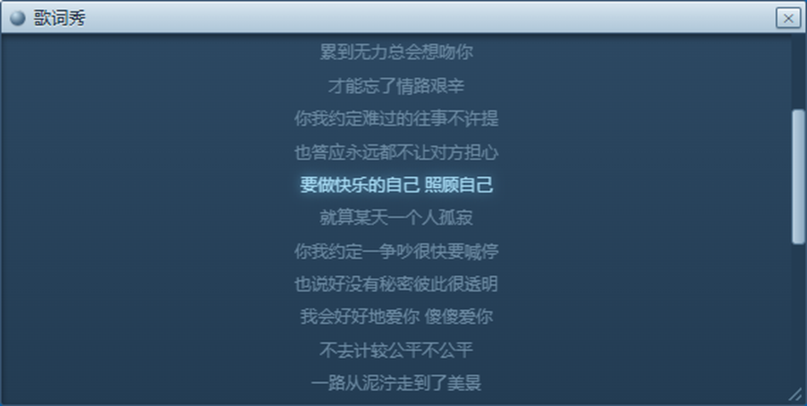
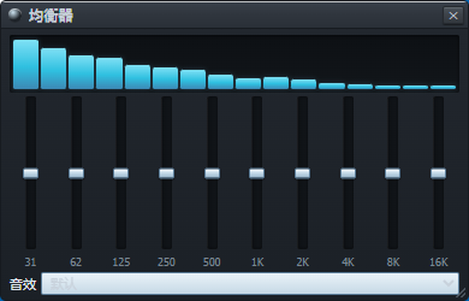
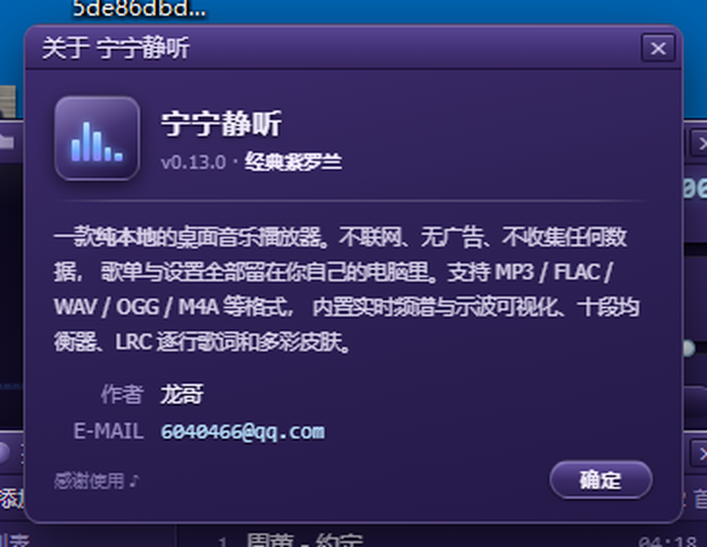
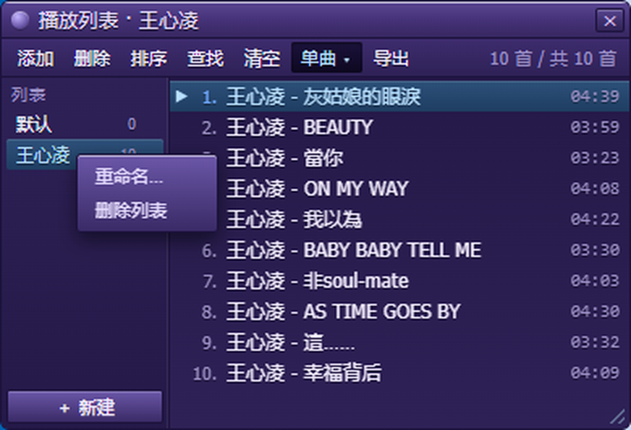
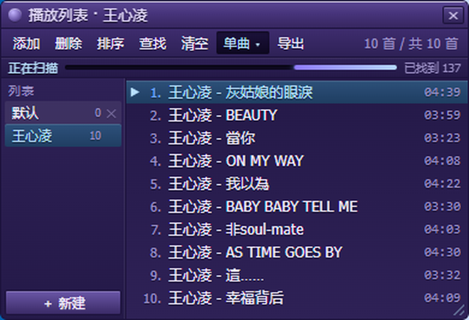

# 宁宁静听 · ttplayer

一款复古风的**纯本地**桌面音乐播放器，向千千静听致敬。

不联网、无广告、不收集任何数据 —— 歌单、皮肤、均衡器设置全部留在你自己的电脑里。



## 特性

**播放**
- 支持 MP3 / FLAC / WAV / OGG / Opus / M4A / AAC
- 播放 / 暂停 / 停止 / 上一首 / 下一首，进度可拖动定位，音量可静音
- 四种播放模式：顺序播放、列表循环、随机播放、单曲循环（下拉菜单直接切换）

**播放列表**
- 多列表并存，侧栏切换；新建、右键重命名、右键删除
- 添加文件 / 添加文件夹（递归扫描子目录）
- 扫描时实时显示进度：走目录阶段报「已找到 N 首」，读标签阶段报「N / M」
- 排序、查找（支持逐条跳转与过滤）、清空、导出列表

**歌词**
- 自动读取与音频同名同目录的 `.lrc`（UTF-8，兼容 BOM）
- 独立歌词秀窗口，逐行高亮滚动

**可视化与音效**
- 实时频谱柱 + 示波显示，可切换「条带 / 背景 / 关闭」三种形态
- 十段均衡器，31Hz – 16kHz，内置 6 组预设（默认 / 流行 / 摇滚 / 古典 / 爵士 / 人声）

**皮肤**
- 三套：经典紫罗兰、经典钢蓝、现代深色，一键切换，重启后保持

**窗口**
- 五窗口架构：主体 + 播放列表、歌词秀、均衡器、关于
- 面板与主体自动贴合排列，任一窗口可独立拖出单独摆放
- 拖到屏幕边缘自动收起为一条细边，鼠标碰到即弹出
- 位置、尺寸、面板开合状态全部记忆，下次启动原样还原
- 窗口整体置顶开关、单实例运行（重复双击只会唤回前台）

## 界面

| 播放列表 | 歌词秀 |
|---|---|
|  |  |

| 十段均衡器 | 关于 |
|---|---|
|  |  |

| 列表右键菜单 | 扫描进度 |
|---|---|
|  |  |

## 技术栈

| 层 | 选型 |
|---|---|
| 外壳 | Tauri 2（Rust） |
| 前端 | 原生 HTML / CSS / JavaScript，无框架、无构建步骤 |
| 音频 | Web Audio API（播放 + 十段 BiquadFilter + AnalyserNode） |
| 元数据 | symphonia 0.6.1（含 id3v1 / id3v2 / ape 特性） |

主体窗口 390 × 160，全部界面由 CSS 变量驱动皮肤，动态生成的弹层必须挂载到 `#app` 内才能继承皮肤变量。

## 快速开始

### 直接用

到 [**Releases**](https://github.com/longjiansina/NNJT/releases/latest) 下载 `v0.14.0.exe`（4.4 MB），双击即运行。单文件绿色版，无需安装、无需额外运行库，改名放哪都能用。

> 首次启动 Windows 可能提示「Windows 已保护你的电脑」（exe 未做代码签名），点「更多信息 → 仍要运行」即可。
> 极少数未装 WebView2 的旧版 Win10 需先安装 [WebView2 Runtime](https://developer.microsoft.com/microsoft-edge/webview2/)。

### 从源码构建

```bash
npm install
npm run build:exe     # 产物：src-tauri/target/release/ttplayer.exe
```

> **必须用 `npm run build:exe`**，它等价于 `cargo build --release --features custom-protocol`。
> Tauri 靠 `custom-protocol` 特性决定「加载内嵌资源」还是「连 http://localhost:1420」，
> 少了它产物会白屏。详见 [docs/BUILD.md](docs/BUILD.md)。

开发调试：

```bash
npm run dev           # tauri dev，前端改动热重载
```

## 配置与数据

| 内容 | 位置 |
|---|---|
| 歌单、当前曲目、皮肤、EQ、示波形态 | `%APPDATA%\com.ttplayer.player\session.json`（含 `.bak` 上一版备份） |
| 窗口位置、尺寸、面板开合 | `%APPDATA%\com.ttplayer.player\window-layout.txt` |
| 皮肤（冗余存一份） | 浏览器 localStorage `ttplayer-skin` |

卸载程序不会自动删除这些文件；想彻底清空手动删除该目录即可。

## 文档

- [架构说明](docs/ARCHITECTURE.md) —— 五窗口模型、事件总线、状态归属、布局与皮肤
- [构建与打包](docs/BUILD.md) —— 开发、构建、打包、分发的坑与约定
- [测试说明](docs/TESTING.md) —— CDP 端到端测试体系、破坏性测试与恢复
- [更新记录](docs/CHANGELOG.md) —— 版本演进

## 目录结构

```
ttplayer/
├── src/                    前端（直接作为 frontendDist，无构建步骤）
│   ├── index.html          单页 + 五个 pane，按 body[data-w] 切换
│   ├── styles.css          皮肤变量与全部样式
│   └── app.js              全部逻辑（窗口、播放、列表、歌词、EQ）
├── src-tauri/
│   ├── src/lib.rs          窗口管理、贴边、布局持久化、文件扫描
│   ├── src/meta.rs         音频元数据读写、WAV 导出
│   ├── src/main.rs         入口
│   ├── capabilities/       窗口权限清单
│   └── tauri.conf.json     窗口与打包配置
├── scripts/                CDP 端到端测试与诊断脚本（Python）
├── docs/                   文档与截图
└── package.json
```

## 作者

龙哥 · 6040466@qq.com

感谢使用 ♪

## 许可证

[MIT](LICENSE) © 2026 longjiansina

可自由使用、修改、分发，包括商业用途，保留版权声明即可。
